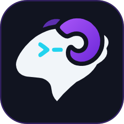
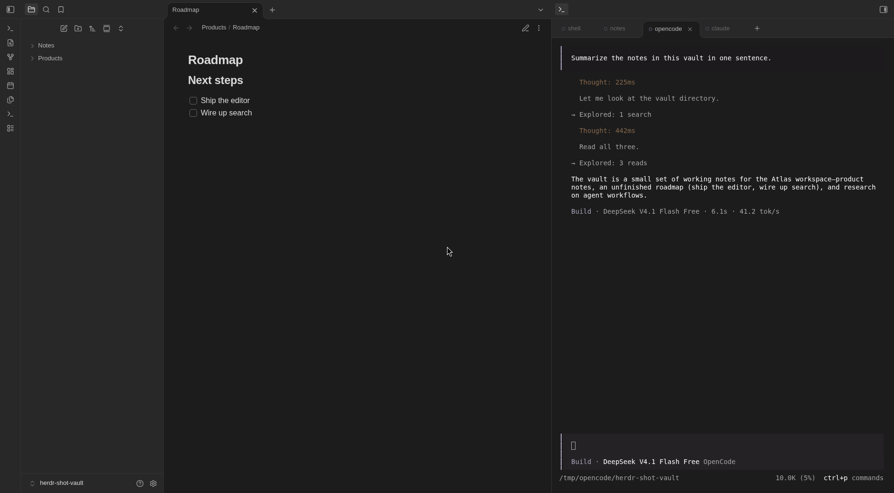
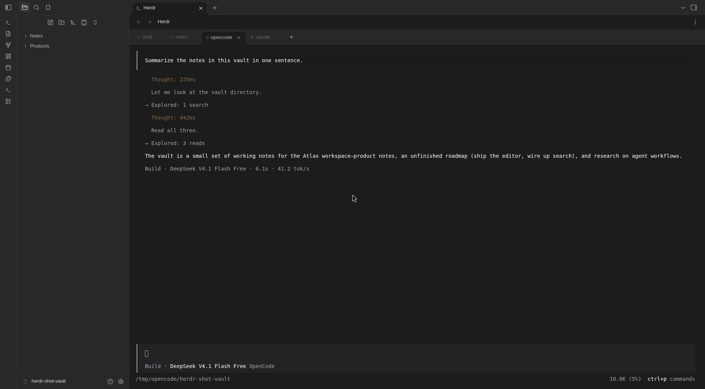

# Herdr

<p align="center">
  
</p>

[](https://obsidian.md)
[](#requirements)
[](https://www.gnu.org/licenses/gpl-3.0)

> **Unofficial plugin.** This is a community plugin for [herdr](https://herdr.dev). It is not made, endorsed or supported by the herdr authors, nor by Obsidian.

**herdr, inside Obsidian.** Run, watch, and switch between your herdr AI coding agents without leaving the vault: embedded terminal tabs, live agent status, drag-and-drop file references, and, from a phone, your laptop's agents plus a sync of the vault.

herdr is the terminal workspace manager for coding agents. This plugin puts the same workspace inside Obsidian, so specs, notes, and the agents working on them stay one click apart.

## Screenshots

Notes and agents, side by side — the herdr terminal sits in Obsidian's right sidebar while you edit:



<details>
<summary>Full-width terminal view</summary>



</details>

## Requirements

- [Obsidian](https://obsidian.md) 1.13.0+, desktop or mobile, as required by `manifest.json`.
- [herdr](https://herdr.dev) and [herdr-bridge](https://github.com/XicuM/herdr-bridge) on the machine where your agents run. The plugin talks to herdr only through herdr-bridge.
- On a phone: a way to reach that machine, e.g. [Tailscale](https://tailscale.com), connected on both devices. The default bridge listens on `127.0.0.1:7788`; its installer configures Tailscale forwarding for access from other devices.

### Network use

The plugin connects only to the herdr-bridge you configure (by default `127.0.0.1:7788`, this machine), to:

- list and control herdr's tabs and agents, and stream their terminals;
- when herdr-bridge runs on another machine (e.g. your laptop, seen from your phone), sync this vault with that machine's vault of the same name.

It sends nothing anywhere else, and has no telemetry. It doesn't access files outside the vault.

### Requires an external program

The plugin does nothing on its own: it needs [herdr](https://herdr.dev) and herdr-bridge, which you install and run yourself. No account or payment is involved.

### What it writes in your vault

Only if you approve the one-time offer (or run **Install agent skill**) is `.agents/skills/herdr-open/SKILL.md` written, with `.claude/skills/herdr-open` linked to it for Claude Code: a short note telling agents how to ask Obsidian to open a note. The command writes it with Obsidian's adapter API because Obsidian's vault API doesn't see hidden folders. Vault sync, with a bridge on another machine, creates and updates notes in the vault.

## Features

### Embedded terminal

- Native-looking tab bar that mirrors Obsidian's note tabs, including the scooped active-tab curves and theme colors.
- Double-click a tab to rename it, right-click for the context menu, middle-click to close.
- Drag tabs to reorder them; the order is persisted in settings.
- Keyboard navigation: `Enter` / `Space` activates a tab, `←` / `→` moves focus.
- The `+` button opens a new shell tab in the vault workspace. When no tabs exist, **New terminal tab** does the same without an agent picker.
- Mouse wheel and `Shift+PageUp` / `Shift+PageDown` scroll the remote pane without disturbing text selection.
- `Ctrl`/`Cmd`+`C` copies a selection, `Ctrl`/`Cmd`+`V` pastes. A real `Ctrl+C` with no selection still sends `SIGINT`.
- File paths and URLs in the buffer are clickable. `Ctrl`/`Cmd`+click opens the link in a new tab.
- On mobile, a key bar adds `Esc`, `Tab`, `Ctrl+C`, arrows, clear and paste.

### Live agent awareness

- Each terminal tab shows an agent status indicator with a text alternative.
- **Switch terminal tab** lists blocked agents first, so you can find agents waiting for input.

### Fast switching

- **Switch terminal tab** opens a fuzzy picker with blocked agents sorted to the top.
- **Next terminal tab** / **Previous terminal tab** cycle tabs from anywhere, in your tab order.
- The switcher lists only existing tabs. **Close conversation** opens a separate picker for closing tabs.
- All herdr harnesses are available: `agy`, `amp`, `claude`, `codex`, `copilot`, `cursor`, `devin`, `gemini`, `grok`, `kimi`, `kiro`, `maki`, `opencode`, `pi`, and `qwen`.

### Drag-and-drop references

Drag a file from Obsidian's file explorer into the terminal, and the plugin inserts its path using the active harness's own mention syntax:

| Harness | No spaces | With spaces |
| --- | --- | --- |
| Claude Code, pi | `@note.md` | `@"my note.md"` |
| Codex | `note.md` | `"my note.md"` |
| opencode, Grok, Antigravity, Copilot | `@note.md` | `@my note.md` |
| Shell / undetected pane | `note.md` | `"my note.md"` |

This mirrors what each harness's own `@` completion inserts. In our testing, only Claude Code turned raw `@path` text into an inline attachment; the others resolved the path by reading it with their file tools.

Dragging selected text inserts it directly, and multiline text is wrapped in bracketed paste so it cannot execute prematurely. Internal wikilinks (`[[Note]]`, `[[Note#Heading]]`) resolve to file paths. Paths are relative to the vault, which is where the agents run.

### Theme-aware terminal

- `Auto` mode reads Obsidian's CSS variables for background, foreground, cursor, and selection colors.
- The terminal background is also sampled from the rendered buffer, so full-screen TUIs and panes with custom backgrounds stay seamless with the tab bar.
- New tabs created by the plugin launch with `COLORFGBG` set for light or dark mode, so tools that read it (Claude Code, Vim, and friends) paint the right palette on the first frame.
- Already-running agents keep their palette; run `/theme light` or `/theme dark` inside them after switching Obsidian's theme.

### Agents open notes in Obsidian

The bridge can push `{"type":"open","vault":"Notes","path":"Note.md","heading":"Intro","line":7}` on `/ws/session`; the plugin then opens that note in Obsidian. Only existing files inside the vault open, and **Let agents open notes** turns it off. On first start with a local bridge, an **Agent skill** tab in the terminal view asks to write `.agents/skills/herdr-open/SKILL.md`, linked from `.claude/skills/herdr-open` (or run **Install agent skill**), which tells agents to run `herdr-bridge obsidian open <path>[#heading] [--line N]`. It needs a herdr-bridge with `obsidian open` (see its [PROTOCOL.md](https://github.com/XicuM/herdr-bridge/blob/main/PROTOCOL.md)); the event carries the vault's name, and other vaults ignore it.

### Vault sync (with a bridge on another machine)

With herdr-bridge on another machine, e.g. your laptop seen from your phone, the plugin syncs this vault with that machine's Obsidian vault of the same name (looked up in Obsidian's vault list there, so any number of vaults work with no setup). Sync is live while Obsidian is open: a note an agent edits on the laptop arrives on the phone about a second later, and your own edits go to the laptop a few seconds after you stop typing. Whatever changed while Obsidian was closed or in the background is caught up when it connects again. The **Sync vault with laptop** command syncs on demand. Live updates from the laptop need herdr-bridge with vault watching; with an older bridge the plugin syncs when it connects and after your edits.

- Each file changed on one side is copied to the other, deletions included (deleted files go to your trash).
- When both sides changed a file, the edit always survives: the laptop's version keeps the path and yours is kept as `<name>.conflict-phone-<time>.<ext>`.
- Hidden folders (`.obsidian` included, so settings and the bridge token stay per device) and build folders are not synced.

With herdr-bridge on this machine there is nothing to sync, so sync doesn't appear at all.

## Installation

The plugin is not in the community directory yet. Build it and copy the three runtime files into your vault:

```bash
npm install
npm run build

mkdir -p "<vault>/.obsidian/plugins/herdr"
cp main.js manifest.json styles.css "<vault>/.obsidian/plugins/herdr/"
```

Then open **Settings → Community plugins**, reload the plugin list, and enable **Herdr**. On a phone, copy the same three files into each vault's `.obsidian/plugins/herdr/` folder.

Vault sync excludes `.obsidian`, so it does not install or update the plugin or copy its settings. Install the plugin and configure its connection separately on each device.

## Getting started

1. Run herdr-bridge where your agents run, and print its token there: `herdr-bridge --print-token`.
2. In the plugin settings, enter the token in **Bridge token**, e.g. `K3MF-9QXA`. It is one token; no secret ID is needed. The field groups characters in fours and lets you show or hide the value. On a phone, also set **Bridge host** to that machine's address (e.g. `100.85.12.34:7788`).
3. Run **Herdr: Open terminal view** from the command palette.
4. Create an agent with **Herdr: New agent conversation**, or open a shell with **Herdr: New terminal tab**.
5. Tabs created in herdr for the same vault workspace appear automatically.

The embedded view takes over a pane while it is attached; other herdr clients step aside, and switching tabs or closing the view releases it.

### Android setup

1. On the laptop, open the vault in desktop Obsidian with Herdr enabled and the local bridge configured. This creates its workspace in the dedicated `herdr-obsidian` session. The phone can only attach to an existing workspace.
2. On Android, use Obsidian 1.13.0 or later and install and enable the plugin in a vault with the same name as the laptop's vault.
3. Keep Tailscale connected on both devices and check the laptop's forwarding with `tailscale serve status`. With the default bridge configuration, sharing a Wi-Fi network alone does not provide access.
4. In Android's Herdr settings, set **Bridge host** to the laptop's Tailscale address and port, e.g. `100.85.12.34:7788`, and enter the token printed by `herdr-bridge --print-token` on the laptop. An empty host uses `127.0.0.1:7788`, which refers to the phone itself.
5. Close settings and run **Herdr: Diagnose connection**. Check that it finds the vault's workspace and tabs, then run **Herdr: Open terminal view**. Use **Herdr: Sync vault with laptop** to check sync separately.

## Commands

| Command | Description |
| --- | --- |
| `Herdr: Open terminal view` | Show or focus the embedded terminal. |
| `Herdr: Switch terminal tab` | Fuzzy-switch existing terminal tabs. |
| `Herdr: Next terminal tab` | Cycle to the next terminal tab. |
| `Herdr: Previous terminal tab` | Cycle to the previous terminal tab. |
| `Herdr: New agent conversation` | Pick a harness (`claude`, `codex`, `opencode`, `agy`, `grok`, …) and start it. |
| `Herdr: New terminal tab` | Open a plain shell in the vault workspace. |
| `Herdr: Rename active tab` | Rename the active herdr tab. |
| `Herdr: Close conversation` | Pick a tab to close. |
| `Herdr: Focus vault workspace` | Ask herdr to focus this vault's workspace. |
| `Herdr: Diagnose connection` | Show the bridge, workspace match, and tab state. |
| `Herdr: Refresh status` | Force a snapshot refresh. |
| `Herdr: Sync vault with laptop` | Sync now (only with a bridge on another machine). |

## Settings

| Setting | Default | Description |
| --- | --- | --- |
| Theme mode | Follow Obsidian | Follow Obsidian, or force the terminal's dark/light palette. |
| Font size | 14 px | Terminal font size. Range 8–32 px. |
| 'Send to agent' menu option | On | Add 'Send to agent' to editor and file context menus. |
| Let agents open notes | On | Open notes when an agent asks through herdr-bridge. |
| Bridge host | `127.0.0.1:7788` | `host:port` of herdr-bridge. On a phone, the laptop's address (e.g. its Tailscale IP). |
| Bridge token | — | One token from `herdr-bridge --print-token`, grouped as `XXXX-XXXX`. Saved tokens are hidden until you choose Show token. The value is stored in this device's plugin settings. |
| Sync automatically | On | Keep the vault in sync live: on connecting, on each change on the laptop, and after your edits (only with a bridge on another machine). |

## How it works

- **Transport.** Everything goes through herdr-bridge: herdr's RPC over HTTP, the terminal over a WebSocket, and live state as snapshots the bridge pushes only when something changed, so the plugin never polls. No Node.js APIs, so the same code runs on desktop and mobile. Requests use herdr's dedicated `herdr-obsidian` session, so agents and workspaces created from Obsidian never clutter the default herdr session or Herdr Mobile.
- **Workspace.** Each vault maps to one herdr workspace, found by pane `cwd` (with a label fallback). With the bridge on this machine it is created on demand; from another machine the plugin only attaches to an existing one, since this vault's path means nothing there.
- **Mobile.** In the background the plugin closes every connection, and reconnects on return. Dropped connections reconnect with backoff.

## Troubleshooting

- **Empty view or connection failure.** Run **Herdr: Diagnose connection** to see snapshot errors, the configured host, and whether a token is set. Connection failures currently have no dedicated offline indicator. Check that herdr-bridge is running and the token is correct.
- **Android cannot connect.** Check that Tailscale is connected on both devices and that `tailscale serve status` on the laptop shows forwarding for port 7788. Set Android's bridge host to the laptop's address, and enter its token separately; vault sync does not copy connection settings.
- **Plugin will not load on Android.** Check that Obsidian is 1.13.0 or later and that `main.js`, `manifest.json`, and `styles.css` are installed in that vault's `.obsidian/plugins/herdr/` folder.
- **An older version asked for a secret ID.** Update the plugin. It now asks only for the token and recovers the value from a saved Obsidian secret ID when available on this device. If authentication still fails, replace the field with the output of `herdr-bridge --print-token`.
- **No workspace or tabs on the phone.** Use the same vault name on both devices and open the vault in desktop Obsidian with Herdr enabled first. The phone attaches to an existing workspace in the `herdr-obsidian` session; tabs in the default herdr session are separate.
- **Sync cannot find the vault.** The laptop's vault must be registered in desktop Obsidian and have the same name as the phone's vault. Sync can work without a herdr workspace, but agent tabs require one.
- **Wrong or missing tabs.** Run **Herdr: Diagnose connection**; it prints the bridge, workspace match, and up to ten tabs.
- **`Terminal session taken over by another client`.** Another herdr client grabbed the pane. Click the tab to re-attach.
- **Agent colors look wrong.** Run `/theme light` or `/theme dark` inside a long-running agent; it only reads the background on startup.

## Development

```bash
npm install
npm run dev    # esbuild watch, inline sourcemap
npm run build  # tsc --noEmit + minified production bundle
npm test       # vitest
npm run lint   # eslint with Obsidian's review rules (eslint-plugin-obsidianmd)
```

| Path | Responsibility |
| --- | --- |
| `src/main.ts` | Plugin lifecycle, commands, settings, workspace creation. |
| `src/herdrClient.ts` | herdr-bridge client: RPC, snapshots, live updates. |
| `src/terminalStream.ts` | A pane's terminal over the bridge's WebSocket. |
| `src/terminalView.ts` | xterm.js view, tab bar, input, links, drag-and-drop. |
| `src/terminalTheme.ts` | Obsidian CSS-variable palette and fallbacks. |
| `src/resolver.ts` | Vault workspace and tab mapping, status sorting. |
| `src/vaultSync.ts` | Two-way vault sync with the bridge's machine: the whole vault, or the files the bridge pushed. |
| `src/switcherModal.ts`, `src/renameModal.ts` | Fuzzy switcher and rename dialog. |
| `styles.css` | Native-style tab bar, status dots, full-bleed layout. |

## Credits

Inspired by [herdr-vscode](https://github.com/XicuM/herdr-vscode) and the herdr workflow. Built with [xterm.js](https://xtermjs.org). Not affiliated with Obsidian or herdr.

## License

[GPL-3.0-or-later](LICENSE)
